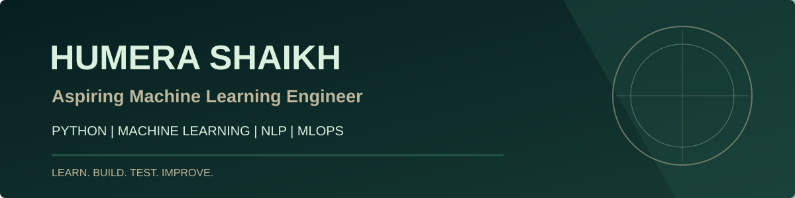

<p align="center">
  
</p>

<p align="center">
  <strong>Machine Learning | Python | NLP | MLOps</strong>
  <br/>
  BCA Graduate | Exploring AI and Building Practical ML Applications
</p>

<p align="center">
  <a href="https://github.com/skhumera0202">
    
  </a>
  <a href="https://www.linkedin.com/in/humerashaikh0202/">
    
  </a>
</p>

---

## 01 — About Me

I'm a BCA graduate interested in **Machine Learning, Artificial Intelligence, Natural Language Processing, and MLOps**.

I enjoy learning through hands-on projects, experimenting with Python libraries, and exploring how machine learning models can be developed and deployed as practical applications.

- Building practical projects to strengthen my technical skills.
- Exploring machine learning concepts and NLP.
- Learning model deployment and MLOps workflows.
- Working toward my goal of becoming a Machine Learning Engineer.

---

## 02 — Tech Stack

### Programming & Data Science

<p>
  
  
  
  
</p>

### Machine Learning & MLOps

<p>
  
  
  
  
  
</p>

### Tools & Platforms

<p>
  
  
  
</p>

---

## 03 — Featured Projects

### 01. Wine Quality Prediction

**Technologies:** Python | Scikit-learn | MLflow | DVC | DagsHub

A machine learning regression project focused on predicting wine quality using physicochemical properties.

**What I worked on:**
- Built a regression model using ElasticNet.
- Used MLflow for experiment tracking.
- Used DVC for data versioning.
- Integrated the project with DagsHub.
- Evaluated model performance using regression metrics.

**Model Evaluation:**

| Metric | Result |
|:---|---:|
| MAE | 0.6189 |
| RMSE | 0.7628 |
| R² Score | 0.1096 |

The evaluation results helped me understand model performance and the importance of improving predictive accuracy.

**Repository:** [Wine Quality Prediction](https://github.com/skhumera0202/mlflow-wine-quality-prediction)

---

### 02. Iris Classification API

**Technologies:** Python | Scikit-learn | BentoML | Docker

A machine learning classification project that deploys an Iris classifier through a REST API.

**What I worked on:**
- Trained a Scikit-learn Iris classification model.
- Saved and loaded the model using BentoML.
- Created a REST API with a `/classify` endpoint.
- Tested API predictions through Swagger.
- Containerized the application using Docker.

**Example Prediction:**

```python
Input: [[5.1, 3.5, 1.4, 0.2]]
Output: [0]
```

**Repository:** [Iris Classification API](https://github.com/skhumera0202/bentoml-iris-classifier)

---

## 04 — GitHub Activity

<p align="center">
  
</p>

---

## 05 — Learning & Growth

I'm continuously strengthening my understanding of:

- Python programming and problem-solving.
- Machine learning algorithms and evaluation metrics.
- Natural Language Processing and text preprocessing.
- Model deployment and REST APIs.
- MLOps, experiment tracking, and data versioning.
- Docker and reproducible development workflows.

<p align="center">
  <strong>Learn → Build → Test → Improve</strong>
</p>

---

## 06 — Let's Connect

<p align="center">
  <a href="https://github.com/skhumera0202">
    
  </a>
  <a href="https://www.linkedin.com/in/humerashaikh0202/">
    
  </a>
</p>

<p align="center">
  I'm interested in connecting with people who enjoy Machine Learning, AI, and building meaningful technology.
</p>

<p align="center">
  <em>Learning continuously. Building consistently. Improving one project at a time.</em>
</p>
